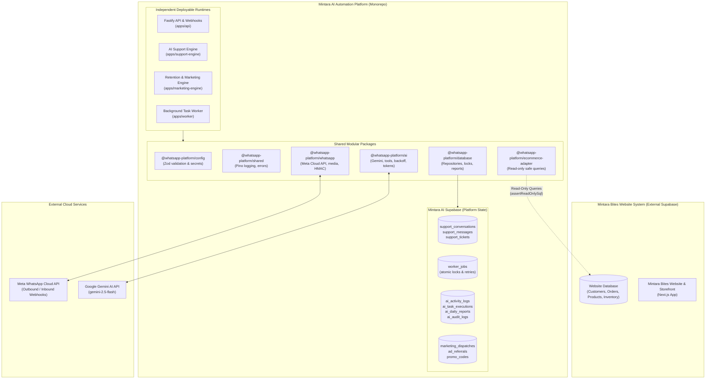
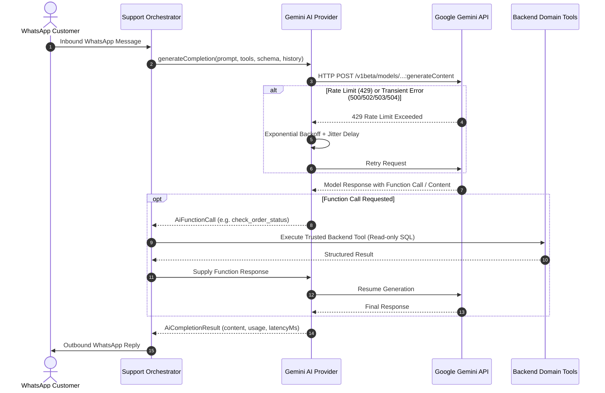
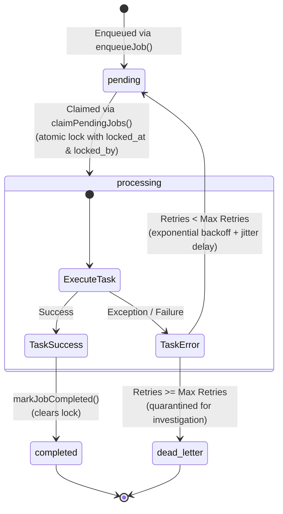
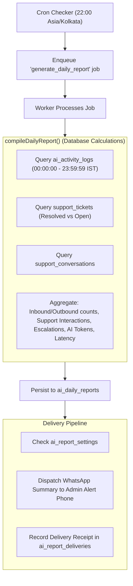

# Architecture Overview: Mintara AI WhatsApp Platform

## 1. System Context & Separation of Concerns

Mintara AI is engineered as an **autonomous, decoupled business AI automation backend ecosystem** for **Mintara Bites**, an artisanal mukhwas and digestive treats brand based in Gujarat, India.

It augments the existing Mintara Bites ecommerce website and database without mutating or degrading primary storefront tables or transactions.

---

## 2. Dual-Database Isolation Model

A core architectural principle of Mintara AI is strict isolation between the platform database and the existing website database:

| Dimension | Mintara AI Platform Supabase | Mintara Bites Website Supabase |
| :--- | :--- | :--- |
| **Role** | Platform State, AI conversations, jobs, logs, reports | Source of Truth for Ecommerce |
| **Data Owned** | Conversations, messages, tickets, jobs, reports, audit | Customers, products, variants, orders, promotions |
| **Permissions** | Full DDL + DML via migrations | Strictly Read-Only (SELECT queries) |
| **Schema / Reset** | Executed via `supabase/schema.sql` & `supabase/delete.sql` | **NEVER** run schema/reset scripts against website DB |
| **Client Access** | `createPlatformSupabaseClient()` | `createEcommerceSupabaseClient()` (HTTPS REST) |
| **Safety Guard** | Row-Level Security (RLS) policies | Guarded by `assertReadOnlySql()` |

### Safety Guardrails
- **SQL Mutation Prevention**: The `@whatsapp-platform/ecommerce-adapter` verifies all SQL statements against destructive keywords (`INSERT`, `UPDATE`, `DELETE`, `DROP`, `TRUNCATE`, `ALTER`) before issuing queries.
- **Credential Separation**: Frontend and client code never receive the Supabase `service_role` key. All database operations are mediated by backend services.

---

## 3. Gemini AI Foundation Architecture

The `@whatsapp-platform/ai` package provides a resilient, type-safe provider abstraction with Google Gemini as the primary engine (`gemini-2.5-flash` or configurable model).

### AI Foundation Guardrails
1. **Zero Direct SQL Execution**: Gemini is strictly prohibited from generating or executing raw SQL queries or receiving database credentials.
2. **Backend Tool Calling Architecture**: Tools (`AiToolDeclaration`) are defined by schema and executed solely by trusted backend services.
3. **Resilient Bounded Backoff with Jitter**: Automatically retries on 429, 500, 502, 503, 504 errors using bounded exponential backoff with randomized jitter.
4. **Token Usage & Latency Tracking**: Records `promptTokens`, `completionTokens`, and `totalTokens` alongside response `latencyMs` in `ai_activity_logs`.
5. **Structured Outputs**: Native support for `responseMimeType: 'application/json'` and `responseSchema` for deterministic JSON synthesis.

---

## 4. WhatsApp Cloud API & Security Foundation

The `@whatsapp-platform/whatsapp` package integrates directly with Meta's official WhatsApp Cloud API:

- **Message Types**: Outbound text, official template messages, interactive reply buttons, interactive section lists, and media messages (image, audio, document, video).
- **Phone Number Normalization**: `normalizePhoneNumber()` converts raw inputs (e.g., `+91 98765 43210`, `09876543210`, `9876543210`) into standardized E.164 digits (`919876543210`).
- **Webhook HMAC Signature Verification**: `verifyWebhookSignature()` computes HMAC-SHA256 of the raw request payload using `WHATSAPP_APP_SECRET` and compares it using `crypto.timingSafeEqual` against the `X-Hub-Signature-256` header.
- **Message Status Webhook Tracking**: Tracks Meta delivery receipts (`sent`, `delivered`, `read`, `failed`) into `messaging_receipts`.
- **Customer Opt-Out / Opt-In**: Recognizes standard opt-out keywords (`STOP`, `UNSUBSCRIBE`, `CANCEL`) and opt-in keywords (`START`, `OPTIN`) to respect customer communication preferences.

---

## 5. Background Worker Concurrency & Retry Infrastructure

The `apps/worker` background processor runs continuously, consuming asynchronous jobs from `public.worker_jobs`.

### Worker Concurrency Features
1. **Atomic Job Claiming**: `claimPendingJobs(workerId, batchSize, lockTimeoutSec)` claims pending and expired-lock jobs using a unique instance ID (`worker_<pid>_<uuid>`).
2. **Lock Expiration Protection**: Jobs whose locks exceed `WORKER_JOB_LOCK_TIMEOUT_MS` (default 5 minutes) are automatically reclaimed if a worker terminates abruptly.
3. **Exponential Backoff & Jitter**: Failed jobs increment `retries` and compute `scheduled_for = now + (baseBackoffMs * 2^(retries - 1)) + jitter`.
4. **Dead-Letter State**: Jobs exceeding `max_retries` (default 3) transition to `dead_letter` for operator inspection.
5. **Graceful Shutdown**: Listens for `SIGTERM` and `SIGINT`, halts the polling loop, and drains active in-flight jobs up to a 10-second timeout.

---

## 6. Daily 22:00 IST Operational Intelligence Reporting

Every day at **22:00 IST (`Asia/Kolkata`)**, the background worker automatically compiles a detailed business and AI operational report.

### Database Reporting Structures
- `ai_activity_logs`: Immutable ledger of every business and AI event (`incoming_message`, `support_interaction`, `order_inquiry`, `human_escalation`, `failed_action`).
- `ai_task_executions`: Tracks background task lifecycles, start/completion times, and error states.
- `ai_daily_reports`: Pre-aggregated daily operational intelligence summaries across business and AI metrics.
- `ai_report_deliveries`: Delivery audit tracking for WhatsApp and dashboard channels.
- `ai_report_settings`: Configurable schedule (`22:00`), timezone (`Asia/Kolkata`), detail level (`detailed`), and recipient numbers.
- `ai_audit_logs`: Sensitive action audit trail for human escalations, refunds, cancellations, and config updates.

---

## 7. Security & Operational Readiness

1. **Authentication**:
   - `isValidAdminToken`: Uses `crypto.timingSafeEqual` across multiple authorized keys (`adminSecret`, `ADMIN_API_KEY`, `ECOMMERCE_WEBHOOK_SECRET`, `defaultPassword`, `legacyPassword`).
   - Timing-safe comparison eliminates timing-attack vulnerabilities.
2. **Rate Limiting**: Configured with `@fastify/rate-limit` to prevent brute-force attacks.
3. **Sensitive Data Redaction**: Pino structured logger masks `authorization`, `cookie`, `token`, `secret`, `password`, and `apiKey`.
4. **Human Approval Safeguards**: Sensitive operations (e.g. refunds, order cancellations, unauthorized discounts) require live human escalation through `support_tickets`.
5. **Observability**:
   - `GET /health`: Liveness probe.
   - `GET /ready`: Readiness probe verifying database connectivity and configuration.
   - `GET /api/reports/daily`: Fetch compiled daily reports.
   - `GET /api/reports/activity-logs`: Inspect granular operational events.
