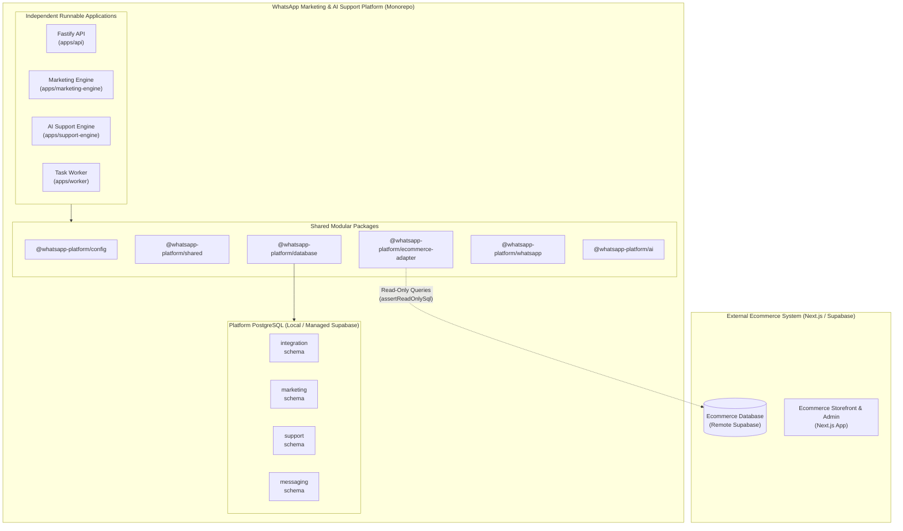

# Architecture Overview: Independent WhatsApp Marketing & AI Support Platform

## 1. System Context & Separation of Concerns

This platform is engineered as an **autonomous, decoupled backend ecosystem** that augments an existing Next.js and Supabase ecommerce application without mutating or degrading the primary store.

---

## 2. Multi-Schema Database Architecture

All platform state is isolated into four dedicated schemas within the platform database:

1. **`integration`**:
   - Manages syncing cursors, webhook logs from the ecommerce store, and ingestion checkpoints.
   - Decoupled from core marketing and conversation models.

2. **`marketing`**:
   - Manages broadcast campaigns, schedule definitions, customer segmentation groups, and conversion attribution.

3. **`support`**:
   - Manages AI conversations, support tickets, customer context memory, escalation events, and intent tracking.

4. **`messaging`**:
   - Manages WhatsApp message dispatch queues, delivery receipts (`sent`, `delivered`, `read`), and inbound webhook payloads.

### Role & Access Isolation:
- `postgres` & `service_role`: Own and execute migrations across platform schemas.
- `anon` & `authenticated`: Default permissions are explicitly revoked from platform internal schemas to enforce least-privilege security.

---

## 3. Safe Dual-Database Isolation Model

A critical architectural constraint is protecting the remote ecommerce production database:

| Dimension | Local Supabase Database | Remote Ecommerce Supabase |
| :--- | :--- | :--- |
| **Role** | Platform State & Schema Ownership | External Read-Only Datasource |
| **Permissions** | Full DDL + DML | Strictly Read-Only (SELECT queries) |
| **Migrations** | Executed via Supabase CLI (`supabase db ...`) | **NEVER** run migrations against this database |
| **Client Pool** | `getLocalDbPool()` | `getEcommerceReadOnlyPool()` |
| **Safety Guard** | Verified local host (`localhost`, `127.0.0.1`) | Guarded by `assertReadOnlySql()` |

### Safety Guardrails
- **Automated Host Check**: Any migration or reset command verifies that the host matches local IP/localhost before execution.
- **SQL Sanitization**: Any SQL intended for the ecommerce database is verified against destructive keywords (`INSERT`, `UPDATE`, `DELETE`, `DROP`, `TRUNCATE`, `ALTER`, etc.).

---

## 4. Independent Application Boundaries

The platform consists of four independently deployable runtimes:

1. **`apps/api` (Fastify Backend API)**:
   - Exposes `GET /health` (liveness) and `GET /ready` (readiness).
   - Ingests inbound webhooks from WhatsApp and the ecommerce platform.
   - Enforces CORS restrictions, Helmet security headers, structured logging, and centralized error handling.

2. **`apps/marketing-engine`**:
   - Long-running scheduler and audience dispatcher.
   - Operates against the `marketing` and `messaging` schemas.

3. **`apps/support-engine`**:
   - Long-running AI customer support orchestrator.
   - Processes customer queries, evaluates context, and drives LLM conversations.

4. **`apps/worker`**:
   - Background job processor handling asynchronous queue dispatch, retry policies, and analytics aggregation.

---

## 5. Security & Zero-Leakage Policy

- **Environment Validation**: Validated at startup with Zod. Missing configuration aborts startup with safe diagnostics.
- **Secret Redaction**: Pino structured logging configures deep redactions for `authorization`, `cookie`, `token`, `secret`, `password`, and `apiKey`.
- **Credential Separation**: The service-role key is never used for general read operations or client-facing responses.
